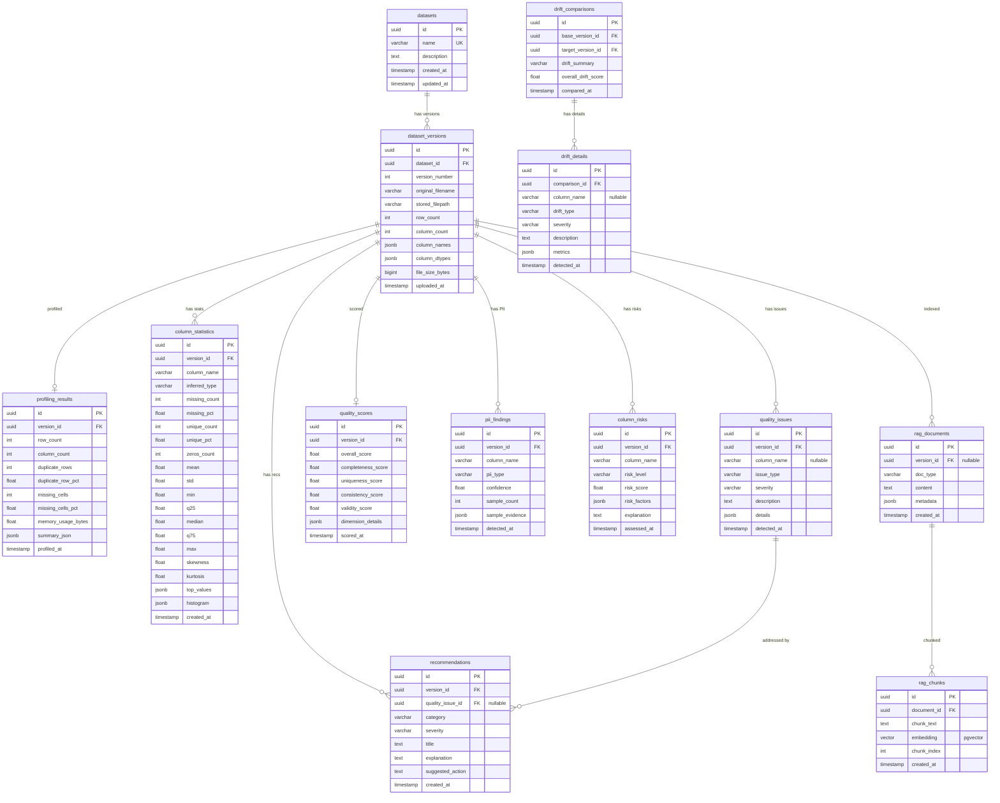

# Phase 0 — Repository Inspection & Project Plan

## 1. Current Project Structure

The repository at `c:\Users\deboj\DataGuard AI` is **completely empty** — no files, no folders, no hidden configuration.

---

## 2. Environment Inventory

| Tool | Status | Version |
|---|---|---|
| Python | ✅ Installed | 3.12.7 (Anaconda) |
| Node.js | ✅ Installed | 24.14.1 |
| npm | ✅ Installed | 11.11.0 |
| Git | ✅ Installed | 2.44.0 |
| pip | ✅ Installed | 24.2 |
| PostgreSQL CLI (`psql`) | ❌ Not on PATH | — |
| Ollama | ❌ Not installed / not on PATH | — |

### Pre-Installed Python Packages (relevant)

| Package | Version | Notes |
|---|---|---|
| pandas | 2.2.2 | ✅ Ready |
| scikit-learn | 1.5.1 | ✅ Ready |
| SQLAlchemy | 2.0.34 | ✅ Ready |
| Alembic | 1.13.3 | ✅ Ready |
| Pydantic | 2.8.2 | ✅ Ready |
| pydantic-settings | 2.6.1 | ✅ Ready |
| openpyxl | 3.1.5 | ✅ Ready |

### Packages Still Needed

| Package | Purpose |
|---|---|
| `fastapi` | Backend API framework |
| `uvicorn[standard]` | ASGI server |
| `python-multipart` | File upload support in FastAPI |
| `ydata-profiling` | Automated dataset profiling |
| `great-expectations` | Data quality validation |
| `presidio-analyzer` | PII detection |
| `presidio-anonymizer` | PII anonymization helpers |
| `psycopg2-binary` | PostgreSQL driver |
| `pgvector` | pgvector support for SQLAlchemy |
| `httpx` | Ollama HTTP client |
| `python-dotenv` | `.env` file loading |
| `aiofiles` | Async file operations |

---

## 3. Existing Database Setup

**None.** PostgreSQL is not installed or not on PATH. The user will need a running PostgreSQL instance (local install, Docker, or cloud) before Phase 3.

---

## 4. What Can Be Reused

Since the repository is empty, there is nothing to reuse. However, the globally-installed Anaconda packages (pandas, scikit-learn, SQLAlchemy, Alembic, Pydantic, openpyxl) will save installation time.

---

## 5. What Needs to Be Created — Everything

Both the backend (Python/FastAPI) and frontend (React/Vite) must be scaffolded from scratch. Database, migrations, services, models, API routes, and the React dashboard are all new.

---

## 6. Proposed Folder Structure

```
DataGuard AI/
├── backend/
│   ├── alembic/                    # Database migrations
│   │   ├── versions/
│   │   ├── env.py
│   │   └── alembic.ini
│   ├── app/
│   │   ├── __init__.py
│   │   ├── main.py                 # FastAPI app entry
│   │   ├── config.py               # Settings / env vars
│   │   ├── database.py             # SQLAlchemy engine & session
│   │   ├── models/                 # SQLAlchemy ORM models
│   │   │   ├── __init__.py
│   │   │   ├── dataset.py          # Dataset, DatasetVersion
│   │   │   ├── profiling.py        # ProfilingResult, ColumnStatistic
│   │   │   ├── quality.py          # QualityIssue, QualityScore
│   │   │   ├── pii.py              # PIIFinding
│   │   │   ├── risk.py             # ColumnRisk
│   │   │   ├── drift.py            # DriftComparison, DriftDetail
│   │   │   └── rag.py              # RAGDocument, RAGChunk
│   │   ├── schemas/                # Pydantic request/response models
│   │   │   ├── __init__.py
│   │   │   ├── dataset.py
│   │   │   ├── profiling.py
│   │   │   ├── quality.py
│   │   │   ├── pii.py
│   │   │   ├── risk.py
│   │   │   ├── drift.py
│   │   │   └── assistant.py
│   │   ├── api/                    # FastAPI routers
│   │   │   ├── __init__.py
│   │   │   ├── datasets.py         # Upload, list, version management
│   │   │   ├── profiling.py        # Trigger & retrieve profiling
│   │   │   ├── quality.py          # Quality checks
│   │   │   ├── pii.py              # PII detection
│   │   │   ├── risk.py             # Risk classification
│   │   │   ├── drift.py            # Version comparison / drift
│   │   │   ├── assistant.py        # RAG + LLM chat
│   │   │   └── reports.py          # Export / download
│   │   └── services/               # Business logic
│   │       ├── __init__.py
│   │       ├── ingestion.py        # File parsing, validation
│   │       ├── profiling.py        # pandas + ydata-profiling
│   │       ├── quality.py          # Great Expectations checks
│   │       ├── pii.py              # Presidio integration
│   │       ├── risk.py             # ML risk classification
│   │       ├── anomaly.py          # Outlier/anomaly detection
│   │       ├── scoring.py          # Quality scoring & prioritization
│   │       ├── recommendations.py  # Remediation suggestions
│   │       ├── drift.py            # Schema/statistical drift
│   │       ├── rag.py              # Document chunking & retrieval
│   │       └── llm.py              # Ollama client
│   ├── uploads/                    # Temporary uploaded file storage
│   ├── requirements.txt
│   └── .env.example
├── frontend/
│   ├── public/
│   ├── src/
│   │   ├── api/                    # API client functions
│   │   ├── components/             # Reusable UI components
│   │   │   ├── Layout/
│   │   │   ├── Charts/
│   │   │   ├── Tables/
│   │   │   ├── Cards/
│   │   │   └── Chat/
│   │   ├── pages/                  # Route-level pages
│   │   │   ├── Dashboard.jsx
│   │   │   ├── DatasetDetail.jsx
│   │   │   ├── VersionCompare.jsx
│   │   │   ├── Upload.jsx
│   │   │   └── Assistant.jsx
│   │   ├── hooks/                  # Custom React hooks
│   │   ├── utils/                  # Helpers / formatters
│   │   ├── App.jsx
│   │   ├── App.css
│   │   ├── index.css
│   │   └── main.jsx
│   ├── index.html
│   ├── package.json
│   └── vite.config.js
├── data/                           # Sample datasets for testing
├── .env                            # Root env (DB URL, Ollama URL, etc.)
├── .gitignore
└── README.md
```

---

## 7. Proposed Database Schema



---

## 8. Proposed API Structure

### Datasets & Versions
| Method | Endpoint | Description |
|---|---|---|
| `POST` | `/api/datasets/upload` | Upload CSV/Excel, create dataset + version |
| `GET` | `/api/datasets` | List all datasets |
| `GET` | `/api/datasets/{id}` | Get dataset with all versions |
| `GET` | `/api/datasets/{id}/versions/{version_id}` | Get specific version details |
| `DELETE` | `/api/datasets/{id}` | Delete dataset and all versions |

### Profiling
| Method | Endpoint | Description |
|---|---|---|
| `POST` | `/api/profiling/{version_id}/run` | Trigger profiling on a version |
| `GET` | `/api/profiling/{version_id}` | Get profiling results |
| `GET` | `/api/profiling/{version_id}/columns` | Get column-level statistics |

### Quality
| Method | Endpoint | Description |
|---|---|---|
| `POST` | `/api/quality/{version_id}/run` | Run quality checks |
| `GET` | `/api/quality/{version_id}/issues` | Get detected issues |
| `GET` | `/api/quality/{version_id}/score` | Get quality score |

### PII
| Method | Endpoint | Description |
|---|---|---|
| `POST` | `/api/pii/{version_id}/scan` | Scan for PII |
| `GET` | `/api/pii/{version_id}` | Get PII findings |

### Risk
| Method | Endpoint | Description |
|---|---|---|
| `POST` | `/api/risk/{version_id}/classify` | Run ML risk classification |
| `GET` | `/api/risk/{version_id}` | Get column risk scores |

### Drift
| Method | Endpoint | Description |
|---|---|---|
| `POST` | `/api/drift/compare` | Compare two versions |
| `GET` | `/api/drift/{comparison_id}` | Get drift comparison result |
| `GET` | `/api/drift/dataset/{dataset_id}` | List all drift comparisons for a dataset |

### Recommendations
| Method | Endpoint | Description |
|---|---|---|
| `GET` | `/api/recommendations/{version_id}` | Get all recommendations |

### Assistant (RAG + LLM)
| Method | Endpoint | Description |
|---|---|---|
| `POST` | `/api/assistant/ask` | Ask a natural-language question |
| `GET` | `/api/assistant/history` | Get chat history for a session |

### Reports / Export
| Method | Endpoint | Description |
|---|---|---|
| `GET` | `/api/reports/{version_id}/download` | Download profiling report (PDF/JSON/CSV) |

---

## 9. Phase-by-Phase Implementation Plan

### Phase 1 — Project Foundation & Backend/Frontend Setup
- Initialize git repository
- Create folder structure (backend + frontend)
- Scaffold FastAPI app with health check
- Scaffold Vite + React app
- Create `.env.example`, `.gitignore`, `requirements.txt`, `package.json`
- Verify both dev servers start

### Phase 2 — Dataset Upload & Ingestion
- Build `POST /api/datasets/upload` endpoint
- File validation (CSV/Excel, size limits, malformed detection)
- Parse with pandas, extract metadata (row count, columns, dtypes)
- Return parsed metadata to frontend
- Build simple Upload page in React

### Phase 3 — PostgreSQL Database & Dataset Versioning
- Set up SQLAlchemy models (datasets, dataset_versions)
- Alembic migration scaffold
- Persist dataset + version on upload
- `GET /api/datasets`, `GET /api/datasets/{id}`
- Handle "same dataset, new version" logic
- Connect frontend dataset list

### Phase 4 — Automated Profiling (pandas + ydata-profiling)
- Build profiling service (column stats, distributions, correlations)
- Store profiling_results + column_statistics in DB
- `POST /api/profiling/{version_id}/run`
- `GET /api/profiling/{version_id}`
- Basic profiling view on frontend

### Phase 5 — Data Quality Engine (Great Expectations)
- Build quality service with expectation suites
- Detect: missing values, duplicates, invalid values, format inconsistencies
- Store quality_issues in DB
- Compute quality_scores (completeness, uniqueness, consistency, validity)
- Quality issues API + frontend display

### Phase 6 — PII Detection (Presidio)
- Integrate Presidio analyzer
- Sample column values, detect PII types
- Store pii_findings in DB
- API + frontend PII warnings

### Phase 7 — ML-Based Column Risk Classification
- Feature engineering from column stats + quality issues + PII
- Train simple scikit-learn classifier (RandomForest/GradientBoosting)
- Assign LOW / MEDIUM / HIGH risk per column
- Store column_risks with explanations
- API + frontend risk display

### Phase 8 — Anomaly/Outlier Detection
- IQR, Z-score, Isolation Forest per numerical column
- Rare-category detection for categoricals
- Store as quality_issues with type=`anomaly`/`outlier`
- API + frontend integration

### Phase 9 — Quality Scoring, Issue Prioritization & Remediation
- Weighted quality scoring across dimensions
- Severity-based issue ranking
- Rule-based recommendation engine
- Store recommendations in DB
- API + frontend recommendation cards

### Phase 10 — Dataset Version Comparison & Drift Detection
- Schema drift (added/removed/type-changed columns)
- Statistical drift (mean, std, distribution via KS-test / Jensen-Shannon)
- Missingness drift, row-count changes
- Categorical distribution drift (chi-squared)
- Store drift_comparisons + drift_details
- API + frontend drift view

### Phase 11 — RAG Knowledge/Context Pipeline
- Generate RAG documents from profiling, quality, PII, risk, drift data
- Chunk documents
- Generate embeddings (local sentence-transformers or Ollama embeddings)
- Store in rag_documents + rag_chunks (pgvector)
- Retrieval function: similarity search given user query

### Phase 12 — Local Ollama LLM Assistant
- Ollama HTTP client service
- System prompt with grounding instructions
- Query → retrieve context → build prompt → call Ollama → return answer
- Handle Ollama unavailable gracefully
- API endpoint `POST /api/assistant/ask`

### Phase 13 — Frontend Dashboard & Visualizations
- Dashboard page (dataset list, quality scores, risk overview)
- Dataset detail page (profiling, stats, charts via Recharts)
- Version comparison page (drift visualizations)
- Responsive layout, dark mode, polished design

### Phase 14 — AI Chat Interface
- Chat component in React
- Message history
- Streaming or polling responses
- Context-aware: current dataset/version scoped queries

### Phase 15 — Reports / Export
- JSON/CSV export of profiling results
- PDF report generation (or downloadable HTML)
- Download endpoint + frontend button

### Phase 16 — Integration Testing & Edge Cases
- Empty datasets, single-row, single-column
- Malformed CSV/Excel
- Huge files (performance guard)
- Missing Ollama / missing PostgreSQL error paths
- API input validation edge cases

### Phase 17 — Final Polishing, Documentation & Demo
- README with setup instructions
- `.env.example` with all variables
- Demo sample datasets in `data/`
- Final UI polish

---

## 10. Architectural Conflicts & Risks Identified

> [!IMPORTANT]
> **PostgreSQL not detected.** `psql` and `pg_isready` are not on PATH. You will need a running PostgreSQL instance before Phase 3. Options:
> - Install PostgreSQL locally (recommended for Windows)
> - Use Docker: `docker run -p 5432:5432 -e POSTGRES_PASSWORD=... postgres:16`
> - Use a cloud-hosted PostgreSQL

> [!IMPORTANT]
> **Ollama not detected.** The `ollama` CLI is not on PATH. Required from Phase 12 onward. Install from [ollama.com](https://ollama.com). A model like `llama3.1:8b` or `mistral` should be pulled. Phases 1–11 will work without Ollama.

> [!WARNING]
> **pgvector extension.** For RAG (Phase 11), PostgreSQL must have the `pgvector` extension installed. If using a standard local install on Windows, you may need to manually install pgvector or use a Docker image that includes it (e.g., `ankane/pgvector`). Fallback: store embeddings as `FLOAT[]` arrays and do brute-force similarity search, which works fine for moderate data sizes.

> [!NOTE]
> **ydata-profiling, great-expectations, presidio** are not currently installed in the Anaconda environment. They will be installed into a project-local virtual environment in Phase 1 to avoid polluting the global env.

> [!NOTE]
> **Virtual environment strategy.** Since the user has Anaconda, I'll create a Python virtual environment inside `backend/` (`python -m venv venv`) to isolate project dependencies cleanly.

---

## Open Questions

> [!IMPORTANT]
> **1. PostgreSQL availability.** Do you already have PostgreSQL installed/running somewhere (Docker, local service, cloud)? If not, which approach do you prefer?

> [!IMPORTANT]
> **2. pgvector.** Do you have pgvector installed in your PostgreSQL, or should I plan a fallback strategy for the RAG embedding storage?

> [!IMPORTANT]
> **3. Ollama.** Do you plan to install Ollama before Phase 12, or should I build a mock/fallback for the LLM assistant that works without Ollama?

> [!NOTE]
> **4. TypeScript vs JavaScript.** For the React frontend — do you have a preference? TypeScript adds type safety but increases boilerplate. I'll default to **JavaScript (JSX)** unless you prefer TypeScript.

> [!NOTE]
> **5. Sample dataset.** Do you have a test dataset you'd like to use, or should I generate synthetic sample CSVs for development and testing?
